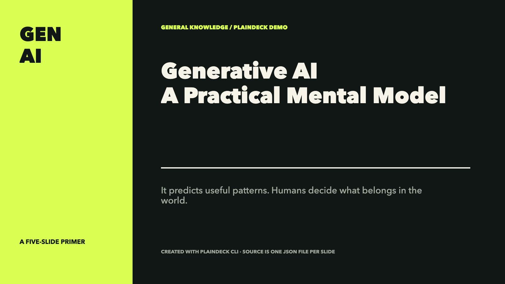
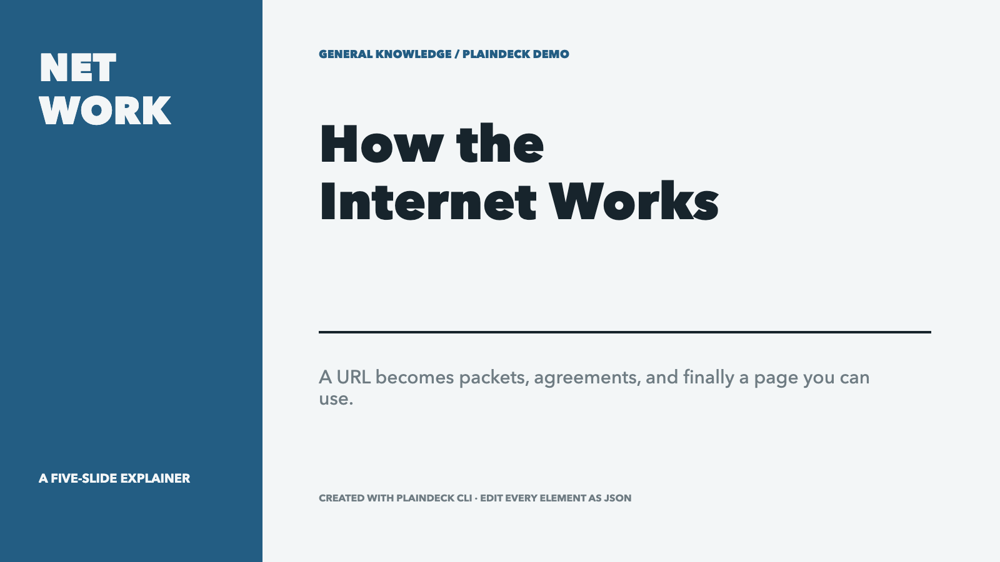
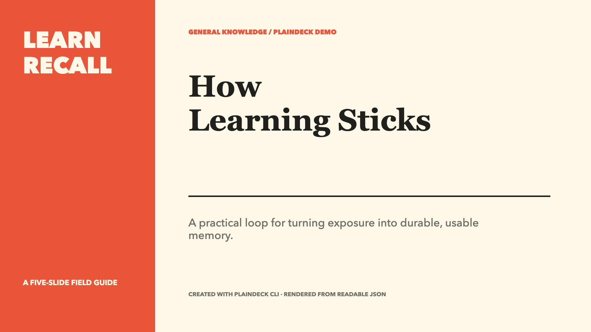

# plaindeck

Agent-friendly API, CLI, and renderer for the PlainDeck Git-native slide format.

```bash
npm install plaindeck
npx plaindeck guide --audience general --minutes 10 --locale en
npx plaindeck init ./my-deck --title "Make the idea visible"
npx plaindeck validate ./my-deck
npx plaindeck inspect ./my-deck --json
npx plaindeck review ./my-deck --locale en --json
```

## Made with `plaindeck`

Each example below is a real five-slide PlainDeck project generated through `init → operations → validate → render`. Click a cover to download the PDF, or open the source to inspect one editable JSON file per slide.

| Generative AI | How the Internet Works | How Learning Sticks |
| --- | --- | --- |
| [](https://github.com/Mappedinfo/PlainDeck/raw/main/demo/renders/generative-ai.pdf) | [](https://github.com/Mappedinfo/PlainDeck/raw/main/demo/renders/how-the-internet-works.pdf) | [](https://github.com/Mappedinfo/PlainDeck/raw/main/demo/renders/how-learning-sticks.pdf) |
| [Source](https://github.com/Mappedinfo/PlainDeck/tree/main/demo/generative-ai) · [PDF](https://github.com/Mappedinfo/PlainDeck/raw/main/demo/renders/generative-ai.pdf) | [Source](https://github.com/Mappedinfo/PlainDeck/tree/main/demo/how-the-internet-works) · [PDF](https://github.com/Mappedinfo/PlainDeck/raw/main/demo/renders/how-the-internet-works.pdf) | [Source](https://github.com/Mappedinfo/PlainDeck/tree/main/demo/how-learning-sticks) · [PDF](https://github.com/Mappedinfo/PlainDeck/raw/main/demo/renders/how-learning-sticks.pdf) |

[Browse the demo gallery and reproduction commands](https://github.com/Mappedinfo/PlainDeck/tree/main/demo).

## CLI

```bash
plaindeck guide --audience faculty --purpose "Explain the mechanism" --minutes 12 --key-message "A shared theme keeps slides consistent" --evidence-depth supported --locale en --json
plaindeck init ./pitch --template pitch --theme night-citrus
plaindeck init ./paper-talk --template nature-methods
plaindeck apply ./my-deck --ops changes.json --dry-run --json
plaindeck add-slide ./my-deck --layout image-right --name "Results"
plaindeck styles --search editorial
cat brief.md | plaindeck add-cards ./my-deck --content - --style editorialMagazine --name "Weekly brief"
cat benchmark.md | plaindeck add-table ./my-deck --data - --style rules --name "Benchmark"
plaindeck review ./my-deck --locale en --json
plaindeck render ./my-deck --format html --output dist/deck.html
plaindeck render ./my-deck --format png --output dist/slides
plaindeck render ./my-deck --format pdf --output dist/deck.pdf
```

`init` preserves the five-slide `showcase` / `studio-cobalt` default. Templates also include `nature-methods` (a seven-slide evidence-led methods talk), `paper-reading`, `pitch`, `flowchart` (five pages that draw a process: pipeline, decision branch with a loop-back, checklist and closing; plus the reusable `process-flow` and `decision-branch` layout presets), and `blank`. Every template ships full English and Chinese copy — pass `{ lang: 'en' | 'zh' }` to `createDeckTemplate`, or let the web editor follow the browser language automatically. `nature-methods` and `paper-reading` default to the light `nature-editorial` theme. Thirteen color systems are available, including four adopted from the open-source [Palette Lab · 色卡实验室](https://mappedinfo.github.io/palette-lab/) academic color archive (`palette-vermillion` 宣纸与朱砂, `palette-ice-magenta` 冰蓝与品红, `palette-jade-ivory` 翡翠与象牙, `palette-jade-night` 翡翠夜; machine-readable archive at [llms-full.txt](https://mappedinfo.github.io/palette-lab/llms-full.txt)).

`add-table` parses Markdown, CSV, TSV, or JSON into a semantic, editable table slide with `rules`, `grid`, or `stripes` styling. `add-cards` turns Juya-style Markdown or JSON into a responsive 1–8 card slide. Both commands use the same operation kernel and renderers as the Web editor. `styles` exposes 174 native recipes batch-compiled from the MIT-licensed Juya catalog.

HTML output is a standalone Web presentation with keyboard navigation, progress, slide names, and fullscreen. PNG/PDF use the same layout renderer in document mode. Rendered sample decks — playable HTML and PDF for every built-in template — live in the editor's [SAMPLES gallery](https://mappedinfo.github.io/PlainDeck/renders/) and under `demo/`.

PNG and PDF rendering require Playwright Chromium:

```bash
npm install playwright
npx playwright install chromium
```

External image requests are blocked by default. Pass `--allow-network` only for trusted projects that intentionally use remote images.

## Presentation guidance

`guide` creates a local authoring prompt from the audience, purpose, duration, central claim and evidence depth. The shared workflow maps claims to evidence, plans each slide, builds native editable elements, then checks content and rendered pages. Visible wording leads with the claim and its supporting evidence; necessary comparisons, negative findings and limitations retain their meaning.

The optional brief accepts `audience: general | faculty | classroom | business | public | archive` (default `general`), `purpose`, `minutes` (greater than 0 and at most 240, default `10`), `keyMessage`, and `evidenceDepth: overview | supported | detailed` (default `supported`). Options also accept `locale: zh | en` (default `zh`). CLI equivalents are `--audience`, `--purpose`, `--minutes`, `--key-message`, `--evidence-depth` and `--locale`.

```ts
import { loadDeck } from 'plaindeck'
import { PresentationBriefSchema, createPresentationGuidance, auditPresentation } from 'plaindeck/core'

const brief = PresentationBriefSchema.parse({ audience: 'faculty', minutes: 12 })
const guidance = createPresentationGuidance({ ...brief, locale: 'en' })
const review = auditPresentation(await loadDeck('./my-deck'), { ...brief, locale: 'en' })
console.log(guidance.prompt)
console.log(review.issues, review.manualChecks)
```

Both core functions run locally and leave the document unchanged. `guide --json` returns the brief, principles, workflow, slide-plan fields and prompt. `review <project> --locale en --json` returns `kind: 'advisory'`, `slideCount`, `issues` and `manualChecks`. Issues locate slides and optional elements and provide suggestions about titles, text density, pending copy, some contrast constructions, geometry, font size, table scale and repeated layouts. These signals complement schema validation; source verification, claim–evidence alignment and rendered visual quality still require review.

The Web toolbar's **Presentation guide** panel stores the brief per project in the local browser, previews and copies the prompt, and navigates review suggestions. The brief stays separate from project JSON and ZIP exports. The panel makes no LLM requests and performs no cloud execution; the chosen Agent executes the copied prompt. See the [production workflow and EasySlides source attribution](https://github.com/Mappedinfo/PlainDeck/blob/main/docs/presentation-guidance.md).

## TypeScript API

```ts
import { applyOperations, createDeckTemplate, loadDeck, saveDeck, validateDeck } from 'plaindeck'
import { renderHtml } from 'plaindeck/render'

const deck = await loadDeck('./my-deck')
const result = applyOperations(deck, [
  {
    op: 'set-element',
    slide: './slides/001-intro.json',
    element: 'title',
    patch: {
      text: 'A new title',
      animation: { enter: 'fade-up', delayFrames: 12, durationFrames: 20 },
    },
  },
  {
    op: 'set-slide-motion',
    slide: './slides/001-intro.json',
    motion: { camera: { fromScale: 1, toScale: 1.04, durationFrames: 150 } },
  },
  {
    op: 'set-footer',
    footer: {
      left: { type: 'slide-name' },
      center: { type: 'date' },
      right: { type: 'page-of-count' },
    },
  },
])

const validation = validateDeck(result.document)
if (!validation.valid) throw new Error(JSON.stringify(validation.issues))
await saveDeck('./my-deck', result.document, result.changedPaths)
const html = renderHtml(result.document)
```

To create a project in memory, call `createDeckTemplate('showcase', { title, theme: 'studio-cobalt' })`; the CLI `init` command uses this same factory.

PlainDeck uses stable slide paths and element IDs so Agent changes remain easy to inspect in Git.

Node-only rendering functions are exported from the package root, while `plaindeck/render` contains the browser-safe pure HTML renderer:

```ts
import { loadDeck, renderPdf, renderPng } from 'plaindeck'

const deck = await loadDeck('./my-deck')
await renderPng(deck, { projectPath: './my-deck', output: './dist/slides' })
await renderPdf(deck, { projectPath: './my-deck', output: './dist/deck.pdf' })
```

For React and video output, the same package ships `plaindeck/react` and `plaindeck/remotion` subpath entries (with `react`, `react-dom` and `remotion` as optional peer dependencies). They use the same layout implementation as HTML/PNG/PDF; Remotion only interprets optional animation and camera metadata.

## MCP server

The same package ships an MCP server (`plaindeck/mcp` subpath, `plaindeck-mcp` bin) exposing the Agent API as Model Context Protocol tools: `presentation_guide`, `review_presentation`, `init`, `validate`, `inspect`, `apply_operations`, `add_cards`, `add_table`, `render`, `styles`. It also exposes the `build_presentation` prompt with optional briefing arguments. Any MCP client — DeepSeek Harness, Claude Code, Codex — can plan, scaffold, edit, validate, review and render decks; edits land as reviewable JSON diffs.

```bash
npm install --global plaindeck
plaindeck-mcp   # stdio server
```

DeepSeek Harness integration (tools appear as `mcp__plaindeck__*`):

```sh
dsh web --patch "$PWD/packages/plaindeck/plaindeck.cordis.yml"
```

Or merge the overlay file's single `insert` patch into `$DSH_HOME/cordis.patch.yml` to keep it across runs. Tools that read or write a project take absolute project paths; `presentation_guide` takes the optional brief and locale, and `styles` takes an optional search query. The server depends on `@modelcontextprotocol/sdk`, which npm installs automatically.

See the [Agent API and operation contract](https://github.com/Mappedinfo/PlainDeck/blob/main/docs/agent-api.md) for native tables, document-level automatic footers, readable motion, presentation guidance, and the MCP tool contract. The project schema remains `0.1`.

## License

MIT
